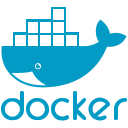
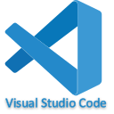

## About Me

Live and work with **Active**, **Proactive**, and **Reactive** skill sets.

- **Active** — look for the problem before it is assigned.
- **Proactive** — automate the repeatable parts so tomorrow needs fewer manual steps.
- **Reactive** — respond fast when something breaks or when requirements change.

Most of my time goes into building with **.NET / C#** and running it on **Azure**, from the containers down to the Linux host underneath. When a design is easier to explain with a picture than with prose, it gets drawn in **LucidChart** first.

## Skills and Tools

**Cloud and Platform**

&nbsp;
&nbsp;
&nbsp;
&nbsp;

**Languages and Frameworks**

&nbsp;
&nbsp;
&nbsp;
&nbsp;

**Editors and Tooling**

&nbsp;
&nbsp;
&nbsp;
&nbsp;

## Connect

Email is the fastest way to reach me.

## Profile Visits

